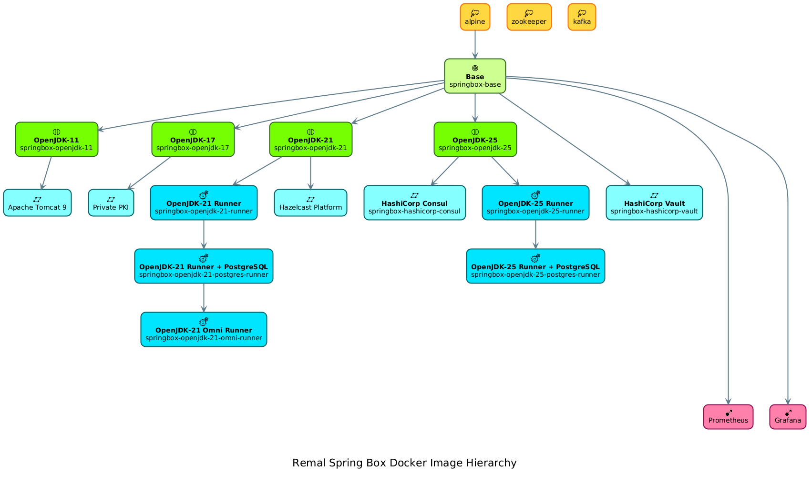

# Remal Spring Box

## 1) Overview
The Remal Spring Box is an open source development platform that provides a ready-for-use development environment best fits best for Spring Boot development and supports Java 23.

The Spring Box that developers use to build applications can also be used in a production environment without modification. It is fully horizontally scalable, uses secure communication channels between the building boxes and provides a full Private Certificate Authority server to issue, renew and revoke server certificates signed by the organisation's root CA.

It also supports advanced real-time monitoring capabilities with time- and counter-based metrics that can be used by the operation teams or managers to measure/present SLAs. Fully customisable charts can easily show the frequency of service calls (e.g. REST endpoints) or the serving time of requests for any service in the Platform.

The services provided by the Spring Box Platform support rapid development for start-ups, small and medium-sized companies. With the Spring Box, IT teams can quickly deliver the IT solutions that what the business needs, and later, as the business evolves, the services and building blocks can be easily improved and replaced with zero downtime.

The platform is best suited for building microservices with Java and Spring Boot.

**The Platform offers:**
* Java Runtime Environment with pre-configured Docker containers with Java 11, 17, 21 and 23

* Java runtime environment containers with embedded database server supporting the 'Database per Service' design pattern

* Platform-wide Private Certificate Authority (PKI) server

* Distributed Service Registry with codeless, automated service registration

* A distributed Key-Value store supporting centralised application configuration management and real-time configuration

* Distributed cache service through three different topologies as embedded cache, client-server cache and near-cache

* Stream processing and event handling with Kafka

* High performance distributed LDAP server

* Open source Access Management solution supporting authentication and authorisation such as OAUTH, SSO, federation, self-registration via Google, Facebook, Twitter, GitHub, etc.

* Collect and display events that occur across the Spring Box, such as user clicks, service call details, user request and response times

* Monitoring of Kafka topic message streams

## 2) Tutorial
* [Link to the tutorial video](https://www.youtube.com/watch?v=sO2GivADjsY)

## 3) Docker Image Hierarchy

## 4) Quick start
### 4.1) Build the Docker images
1. Start a `Tomcat`.
2. Download the installation files from [here](https://drive.google.com/drive/u/0/folders/1RUkp1vwSX0aTdlQ2zgyOUKQexHovHY77) and copy them under the `$TOMCAT_HOME/webapps/docker-build/` directory.
3. Use the `./update-binaries.sh 1` command to copy the installation files into the image build directories.
4. Build the Docker images using the `./sb.sh abcdeu` command.

### 4.2) Build the Java projects

    $ cd springbox/projects
    $ mvn clean package 

### 4.3) Start the sample docker stack

    $ cd springbox/projects
    $ ./sb.sh i1

## 5) Monitoring
#### Total number of REST endpoint calls

  

  

#### Serving time of REST calls
  

  

#### Kafka consumed messages

  

  

## 5) Contributions are welcome
Please help improve this project.

You can open a bug report or submit a new pull request with new features, fixes or improvements.

## 7) Thank you for buying me a coffee
* **Wise, EUR/USD**:

   

* [**PayPal, EUR**](https://www.paypal.com/donate/?hosted_button_id=VT6RPK363U5CA):

  

* [**PayPal, USD**](https://www.paypal.com/donate/?hosted_button_id=U5JFBSZ23YGP4):

  

## 7) License and Copyright
Copyright (c) 2020-2026 Remal Software, Arnold SOMOGYI. All rights reserved.

## Appendix 1) Service registry screenshot

## Appendix 2) Keep database primary keys in sync when using the `Database per Service` architecture

### Context:
Let’s imagine you are developing an application using the microservice architecture pattern.
Services need to persist data in some kind of database. For example, the Customer Service stores information about customers and the Order service stores information about orders.

### Problem:
Let's say we have a high load on customer service, so we start 10 service instances.
So we have 10 microservices, and each has its own database, and all the REST GET services are behind a load balancer (or service registry).
Now a client wants to persist a customer.
Load balancer sends the request to service instance 9/10, and the customer is created.
The next request comes from the same client who wants to confirm that the customer has been created and view their details.
This request arrived to instance 3/10.

### Challenges
* How to ensure that service 3/10 syncs the newly created customer with the database of service 9/10.
* How to initialize (fill in with data) the empty database of a new service instance that has just started?
* How to keep in sync the primary keys (PK) in the databases between the separated service instances in case of errors and rollbacks while using sequences to generate the PKs?
* How to separate the `get data` and the `insert/update data` operations?

### Solution:

[Link to the tutorial video](https://www.youtube.com/watch?v=EM9Z9gI8jMg)

You should be familiar with the following design patterns:
* Database per service design pattern
* Command Query Responsibility Segregation design pattern (CQRS)
* Generating Unique, URL friendly IDs in distributed systems using Nano ID

## License and Copyright
Contact:   arnold.somogyi@gmail.com

Copyright: Copyright (c) 2020-2026 Remal Software

This work is licensed under the Creative Commons Attribution-NonCommercial 4.0 International License.
To view a copy of this license, visit: https://creativecommons.org

You are free to share and adapt the material for personal or hobby purposes, provided you give appropriate credit and do not use the material for commercial gain.

